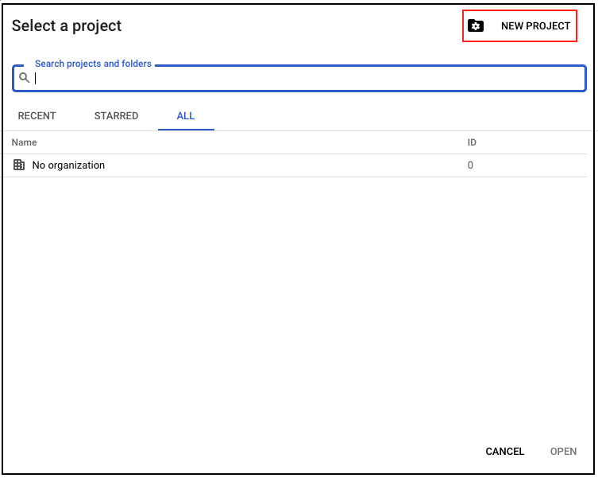
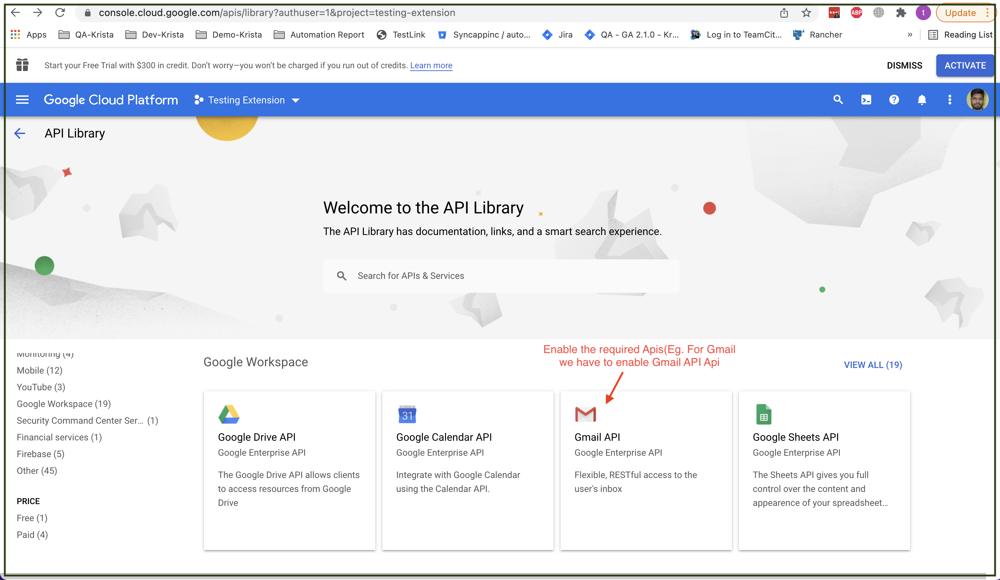
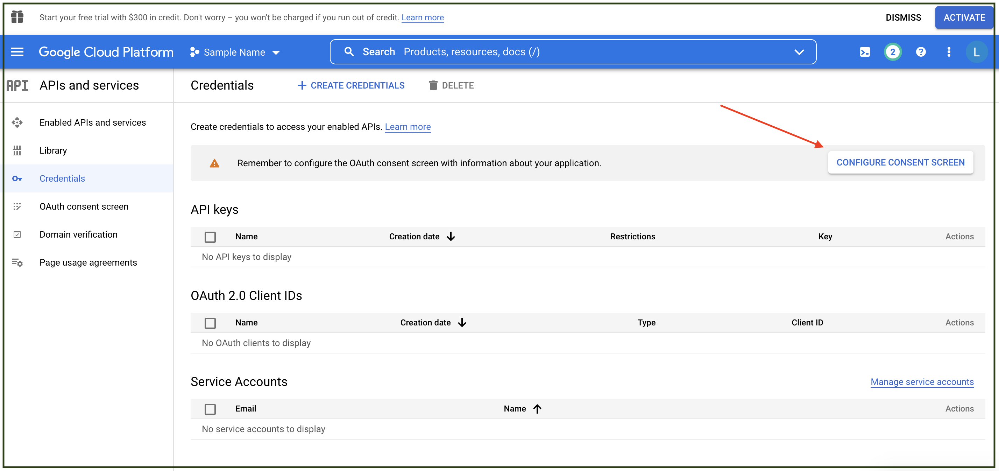
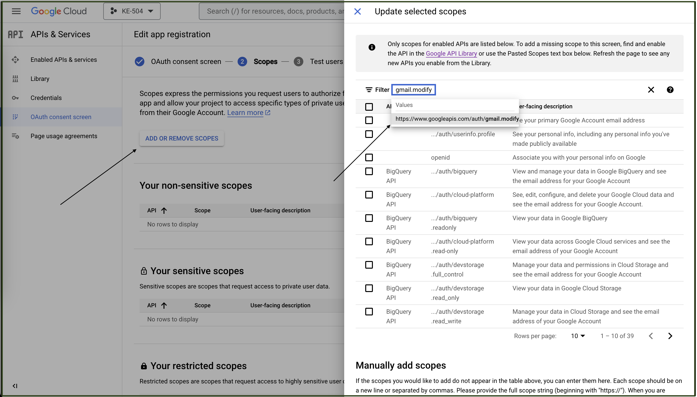
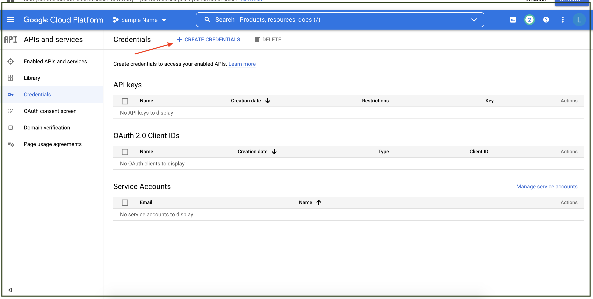
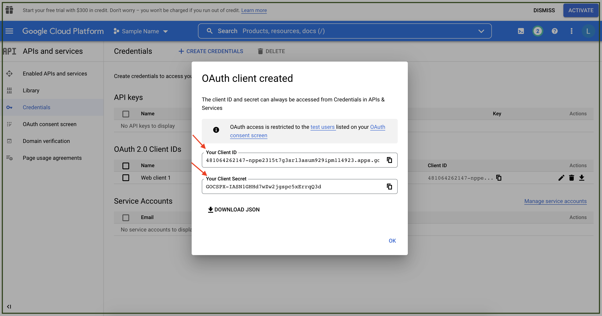
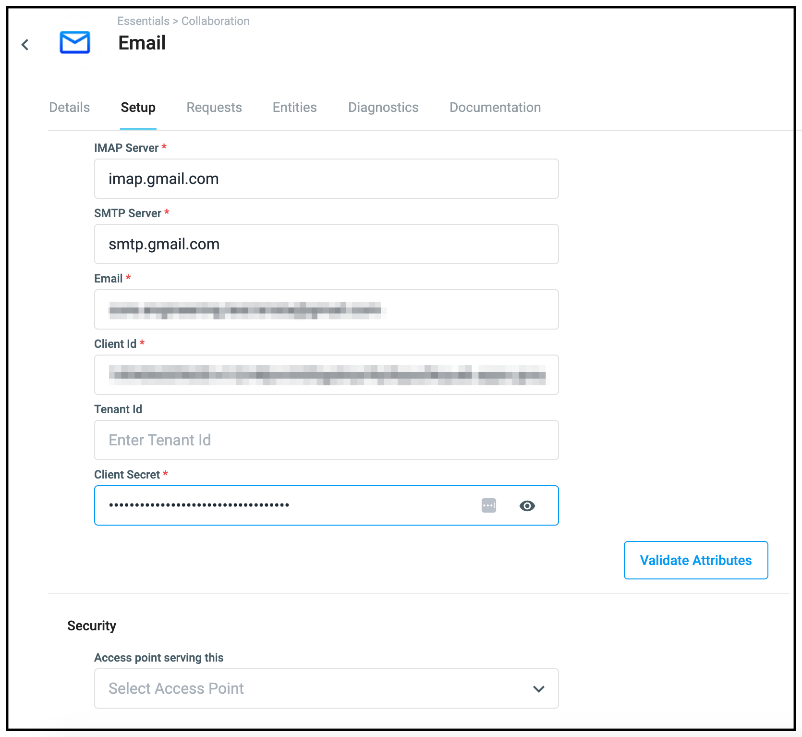

# Creating Gmail App

## Overview

This guide provides step-by-step instructions for creating an OAuth 2.0 application in Google Cloud Console to enable Gmail integration with the Krista Email Extension.

## Prerequisites

- Google account (Gmail or Google Workspace)
- Access to Google Cloud Console
- Krista platform instance URL

## Step-by-Step Setup

### Step 1: Create Google Cloud Project

1. Go to [Google Cloud Console](https://console.cloud.google.com/)
2. Click **Select a project** dropdown at the top
3. Click **NEW PROJECT**
4. Enter project details:
   - **Project name**: `Krista Email Integration` (or your preferred name)
   - **Organization**: Select your organization (if applicable)
5. Click **CREATE**
6. Wait for project creation to complete



### Step 2: Enable Gmail API

1. In the Google Cloud Console, select your project
2. Navigate to **APIs & Services** > **Library**
3. Search for **Gmail API**
4. Click on **Gmail API** from the results
5. Click **ENABLE**
6. Wait for the API to be enabled



> **📝 Note**: Enabling the Gmail API is required for OAuth 2.0 authentication to work properly.

### Step 3: Configure OAuth Consent Screen

1. Navigate to **APIs & Services** > **OAuth consent screen**
2. Select **User type**:
   - **Internal**: For Google Workspace users only (recommended for enterprise)
   - **External**: For any Google account (required for personal Gmail)
3. Click **CREATE**

#### Fill in App Information

**App information:**
- **App name**: `Krista Email Extension`
- **User support email**: Your email address
- **App logo**: (Optional) Upload Krista logo

**App domain:**
- **Application home page**: `https://your-krista-domain.com`
- **Application privacy policy link**: Your privacy policy URL
- **Application terms of service link**: Your terms of service URL

**Authorized domains:**
- Add your Krista domain: `your-krista-domain.com`

**Developer contact information:**
- **Email addresses**: Your email address

4. Click **SAVE AND CONTINUE**



#### Add Scopes

1. Click **ADD OR REMOVE SCOPES**
2. Filter for **Gmail API**
3. Select the following scope:
   - `https://mail.google.com/` - Read, compose, send, and permanently delete all your email from Gmail
4. Click **UPDATE**
5. Click **SAVE AND CONTINUE**



> **⚠️ Important**: The `https://mail.google.com/` scope is required for both IMAP and SMTP access. More granular scopes like `gmail.readonly` do not support IMAP/SMTP authentication.

#### Add Test Users (External Apps Only)

If you selected **External** user type and your app is in testing mode:

1. Click **ADD USERS**
2. Enter email addresses of users who should have access
3. Click **ADD**
4. Click **SAVE AND CONTINUE**

> **📝 Note**: Apps in testing mode have a 7-day refresh token expiration. Publish your app to production to remove this limitation.

### Step 4: Create OAuth 2.0 Credentials

1. Navigate to **APIs & Services** > **Credentials**
2. Click **CREATE CREDENTIALS** > **OAuth client ID**
3. Select **Application type**: **Web application**
4. Enter **Name**: `Krista Email Extension Client`

#### Configure Authorized Redirect URIs

1. Under **Authorized redirect URIs**, click **ADD URI**
2. Enter your Krista redirect URI:
   ```
   https://your-krista-domain.com/api/extension/oauth2/callback
   ```
   **Example**:
   ```
   https://app.krista.ai/api/extension/oauth2/callback
   ```

3. Click **CREATE**



> **⚠️ Critical**: The redirect URI must match exactly (including https://, path, and no trailing slash). Any mismatch will cause authentication to fail.

### Step 5: Save OAuth Credentials

1. A dialog will appear with your **Client ID** and **Client Secret**
2. **Copy and save** both values securely:
   - **Client ID**: `123456789-abc.apps.googleusercontent.com`
   - **Client Secret**: `GOCSPX-xxxxxxxxxxxxx`
3. Click **OK**



> **🔒 Security**: Never share your Client Secret publicly or commit it to version control. Store it securely.

### Step 6: Configure Email Extension in Krista

1. Log in to Krista Studio
2. Navigate to **Extensions**
3. Add **Email Extension**
4. Fill in configuration parameters:

```
IMAP Server: imap.gmail.com
SMTP Server: smtp.gmail.com
Email: your-email@gmail.com
Client ID: 123456789-abc.apps.googleusercontent.com
Client Secret: GOCSPX-xxxxxxxxxxxxx
Tenant ID: (leave empty for Gmail)
```

5. Click **Save**

### Step 7: Test Connection

1. Click **Test Connection** button
2. You will be redirected to Google login page
3. Sign in with your Gmail account
4. Review the permissions requested:
   - Read, compose, send, and permanently delete all your email from Gmail
5. Click **Allow**
6. You will be redirected back to Krista
7. Connection status should show **Connected**



## Publishing Your App (Optional but Recommended)

### Why Publish?

- **Testing Mode**: Refresh tokens expire after 7 days, requiring frequent re-authentication
- **Production Mode**: Refresh tokens do not expire (unless revoked), providing seamless long-term access

### How to Publish

1. Navigate to **OAuth consent screen** in Google Cloud Console
2. Click **PUBLISH APP**
3. Review the warning and click **CONFIRM**
4. Your app status will change to **In production**

> **📝 Note**: For apps requesting sensitive scopes (like `https://mail.google.com/`), Google may require verification. This process can take several weeks.

### Verification Process

If Google requires verification:

1. You'll see a **Submit for verification** button
2. Click it and follow the instructions
3. Provide:
   - App description and use case
   - Privacy policy and terms of service
   - Video demonstration of your app
   - Domain verification
4. Wait for Google's review (typically 3-6 weeks)

## Troubleshooting

### Issue: "redirect_uri_mismatch" Error

**Cause**: Redirect URI in Google Cloud Console doesn't match Krista's redirect URI

**Solution**:
1. Get exact redirect URI from Krista: `https://<your-domain>/api/extension/oauth2/callback`
2. Go to **Credentials** > Edit your OAuth client
3. Add the exact URI to **Authorized redirect URIs**
4. Save and retry

### Issue: "Access blocked: This app's request is invalid"

**Cause**: OAuth consent screen not configured or missing required fields

**Solution**:
1. Complete all required fields in OAuth consent screen
2. Add authorized domain
3. Add required scopes
4. Save and retry

### Issue: "This app isn't verified"

**Cause**: App is in testing mode or not verified by Google

**Solution**:
1. For testing: Click **Advanced** > **Go to [App Name] (unsafe)**
2. For production: Publish app and complete verification process

### Issue: Refresh token expires after 7 days

**Cause**: App is in testing mode

**Solution**:
1. Publish app to production (see Publishing section above)
2. Or add users as test users and re-authenticate every 7 days

## Security Best Practices

1. **Rotate Client Secrets**: Change your client secret every 90 days
2. **Limit Scopes**: Only request the scopes you need
3. **Monitor Usage**: Review OAuth consent screen regularly
4. **Use HTTPS**: Always use HTTPS for redirect URIs
5. **Secure Storage**: Store Client Secret as a secured parameter in Krista

## Next Steps

After successfully creating your Gmail app:

1. Review [Authentication](pages/Authentication.md) to understand OAuth 2.0 flow
2. Test catalog requests:
   - [Send Mail](pages/SendMail.md)
   - [Retrieve Unread Emails](pages/RetrieveUnreadEmailsFromFolder.md)
3. Integrate into your Krista workflows

## See Also

- [Extension Configuration](pages/ExtensionConfiguration.md) - Configuration parameters
- [Authentication](pages/Authentication.md) - OAuth 2.0 authentication details
- [Creating Outlook App](pages/CreatingOutlookApp.md) - Outlook OAuth setup

## Additional Resources

- [Google Cloud Console](https://console.cloud.google.com/)
- [Gmail API Documentation](https://developers.google.com/gmail/api)
- [OAuth 2.0 for Web Server Applications](https://developers.google.com/identity/protocols/oauth2/web-server)
- [OAuth 2.0 Scopes for Google APIs](https://developers.google.com/identity/protocols/oauth2/scopes)

