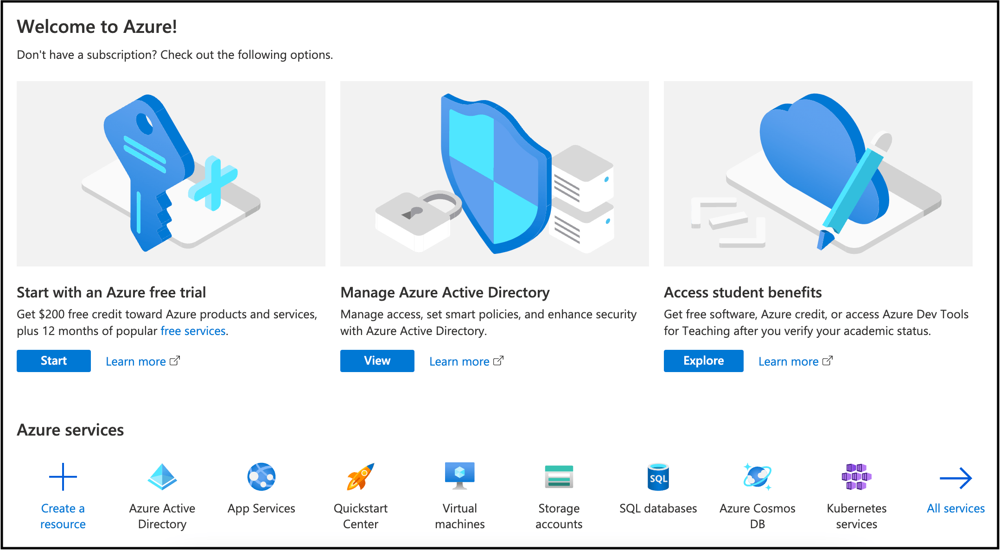
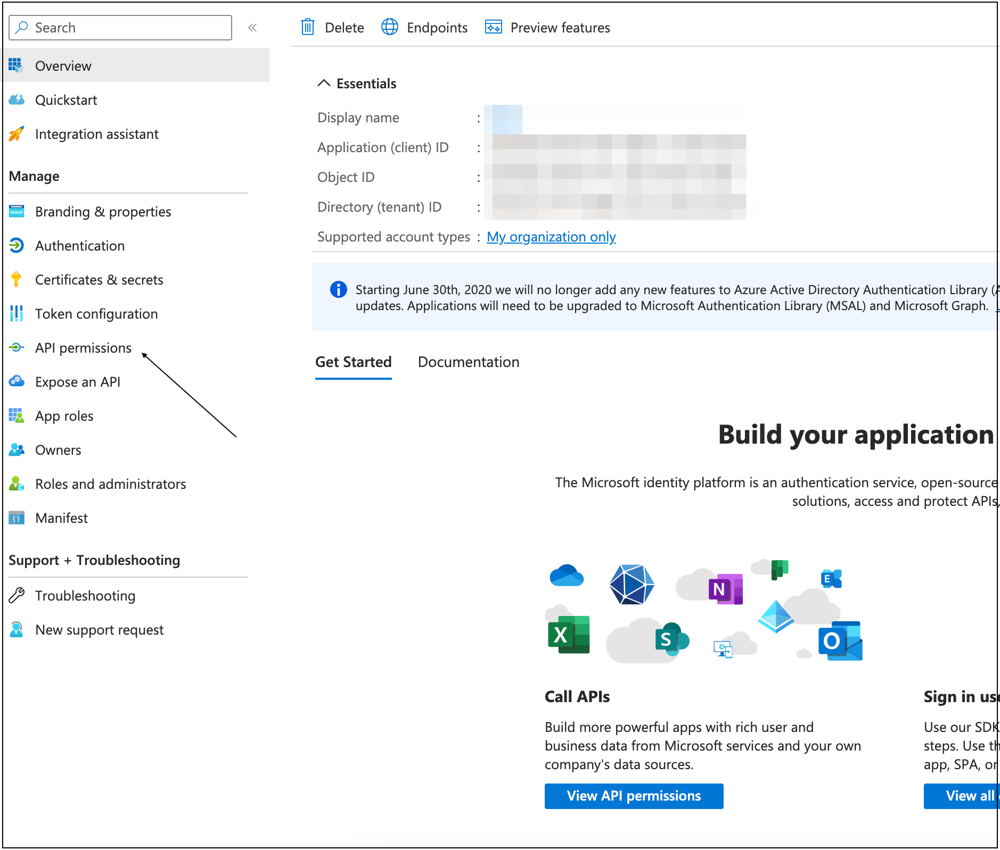
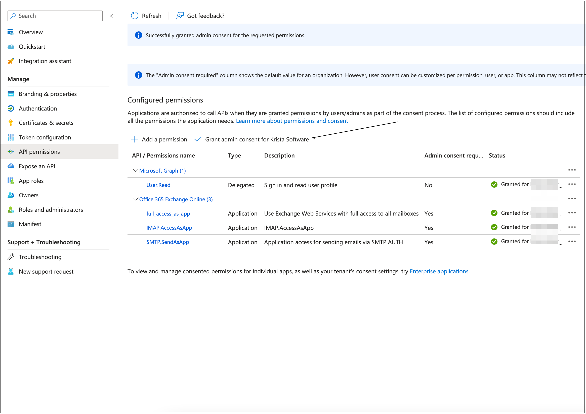
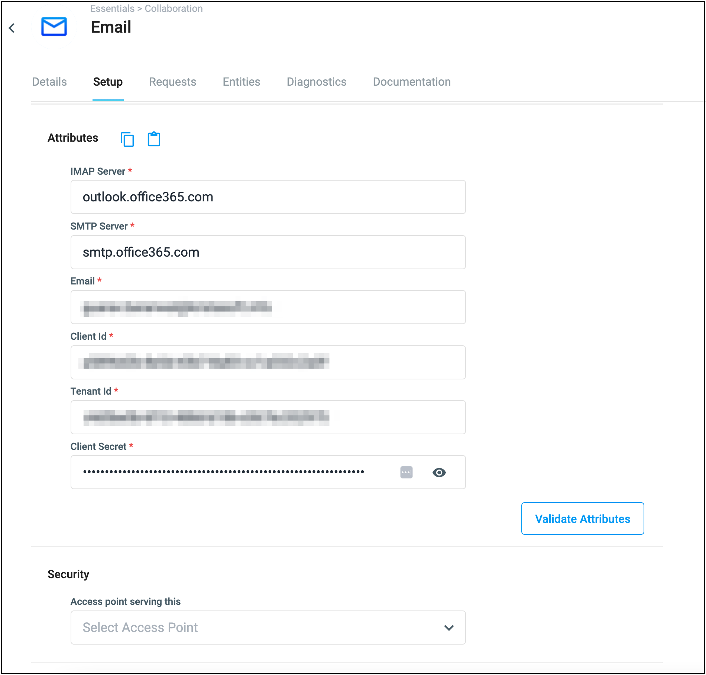

# Creating Outlook App

## Overview

This guide provides step-by-step instructions for creating an OAuth 2.0 application in Azure Portal to enable Outlook/Office 365 integration with the Krista Email Extension.

## Prerequisites

- Microsoft account (Outlook.com or Office 365)
- Access to Azure Portal
- Azure Active Directory (Azure AD) tenant
- Krista platform instance URL

## Step-by-Step Setup

### Step 1: Access Azure Portal

1. Go to [Azure Portal](https://portal.azure.com/)
2. Sign in with your Microsoft account
3. Navigate to **Azure Active Directory**



### Step 2: Register Application

1. In Azure Active Directory, click **App registrations** in the left menu
2. Click **New registration**
3. Fill in application details:
   - **Name**: `Krista Email Extension`
   - **Supported account types**: Select one of:
     - **Accounts in this organizational directory only** (Single tenant - recommended for enterprise)
     - **Accounts in any organizational directory** (Multi-tenant)
     - **Accounts in any organizational directory and personal Microsoft accounts** (For Outlook.com support)
   - **Redirect URI**: 
     - Platform: **Web**
     - URI: `https://your-krista-domain.com/api/extension/oauth2/callback`
4. Click **Register**


> **⚠️ Critical**: The redirect URI must match exactly (including https://, path, and no trailing slash).

### Step 3: Note Application (Client) ID and Tenant ID

After registration, you'll see the **Overview** page:

1. **Copy and save** the following values:
   - **Application (client) ID**: `xxxxxxxx-xxxx-xxxx-xxxx-xxxxxxxxxxxx`
   - **Directory (tenant) ID**: `xxxxxxxx-xxxx-xxxx-xxxx-xxxxxxxxxxxx`


> **📝 Note**: Both Client ID and Tenant ID are required for Outlook configuration.

### Step 4: Create Client Secret

1. In the left menu, click **Certificates & secrets**
2. Click **New client secret**
3. Fill in details:
   - **Description**: `Krista Email Extension Secret`
   - **Expires**: Select expiration period (recommended: 24 months)
4. Click **Add**
5. **Copy and save** the **Value** immediately (it won't be shown again):
   - **Client Secret**: `xxxxxxxxxxxxxxxxxxxxx`


> **🔒 Security**: Copy the secret value immediately. It will only be displayed once. Store it securely and never share it publicly.

### Step 5: Configure API Permissions

1. In the left menu, click **API permissions**
2. Click **Add a permission**
3. Select **Microsoft Graph** (not Office 365 Exchange Online)
4. Select **Delegated permissions**
5. Search and add the following permissions:
   - `IMAP.AccessAsUser.All` - Read, write, send, and permanently delete all user mail via IMAP
   - `SMTP.Send` - Send mail as a user via SMTP
   - `offline_access` - Maintain access to data you have given it access to

6. Click **Add permissions**



> **📝 Note**: The `offline_access` scope is required to obtain refresh tokens for long-term access.

### Step 6: Grant Admin Consent (Optional)

If you're an admin and want to pre-approve permissions for all users:

1. Click **Grant admin consent for [Your Organization]**
2. Click **Yes** to confirm
3. Status will change to **Granted for [Your Organization]**



> **📝 Note**: If you don't grant admin consent, each user will be prompted to consent when they first authenticate.

### Step 7: Configure Authentication Settings

1. In the left menu, click **Authentication**
2. Under **Implicit grant and hybrid flows**, ensure both are **unchecked**:
   - ❌ Access tokens
   - ❌ ID tokens
3. Under **Allow public client flows**, select **No**
4. Click **Save**

> **📝 Note**: These settings ensure the app uses the secure authorization code flow with PKCE, not the less secure implicit flow.

### Step 8: Configure Email Extension in Krista

1. Log in to Krista Studio
2. Navigate to **Extensions**
3. Add **Email Extension**
4. Fill in configuration parameters:

```
IMAP Server: outlook.office365.com
SMTP Server: smtp.office365.com
Email: your-email@company.com
Client ID: xxxxxxxx-xxxx-xxxx-xxxx-xxxxxxxxxxxx
Client Secret: xxxxxxxxxxxxxxxxxxxxx
Tenant ID: xxxxxxxx-xxxx-xxxx-xxxx-xxxxxxxxxxxx
```

5. Click **Save**

### Step 9: Test Connection

1. Click **Test Connection** button
2. You will be redirected to Microsoft login page
3. Sign in with your Outlook/Office 365 account
4. Review the permissions requested:
   - Read, write, send, and permanently delete all user mail via IMAP
   - Send mail as a user via SMTP
   - Maintain access to data you have given it access to
5. Click **Accept**
6. You will be redirected back to Krista
7. Connection status should show **Connected**



## Understanding Scopes

### IMAP.AccessAsUser.All

- **Full Scope URL**: `https://outlook.office365.com/IMAP.AccessAsUser.All`
- **Permission Level**: Delegated
- **Description**: Allows the app to read, write, send, and permanently delete all user mail via IMAP protocol
- **Required For**: Retrieving emails, moving messages, accessing folders

### SMTP.Send

- **Full Scope URL**: `https://outlook.office365.com/SMTP.Send`
- **Permission Level**: Delegated
- **Description**: Allows the app to send mail as the signed-in user via SMTP protocol
- **Required For**: Sending emails

### offline_access

- **Full Scope URL**: `offline_access`
- **Permission Level**: Delegated
- **Description**: Allows the app to maintain access to data even when the user is not actively using the app
- **Required For**: Obtaining refresh tokens for automatic token renewal

## Troubleshooting

### Issue: "AADSTS50011: The redirect URI specified in the request does not match"

**Cause**: Redirect URI in Azure app registration doesn't match Krista's redirect URI

**Solution**:
1. Get exact redirect URI from Krista: `https://<your-domain>/api/extension/oauth2/callback`
2. Go to **App registrations** > Your app > **Authentication**
3. Add the exact URI to **Redirect URIs**
4. Save and retry

### Issue: "AADSTS65001: The user or administrator has not consented"

**Cause**: Required permissions not granted

**Solution**:
1. Go to **API permissions**
2. Verify all required scopes are added
3. Click **Grant admin consent** (if you're an admin)
4. Or have each user consent during first login

### Issue: "Tenant ID cannot be null or empty"

**Cause**: Tenant ID not provided in extension configuration

**Solution**:
1. Go to Azure Portal > **Azure Active Directory** > **Overview**
2. Copy **Tenant ID**
3. Add it to extension configuration in Krista
4. Save and retry

### Issue: Client secret expired

**Cause**: Client secret has reached its expiration date

**Solution**:
1. Go to **Certificates & secrets**
2. Create a new client secret
3. Update extension configuration with new secret
4. Delete old secret after verifying new one works

## Security Best Practices

1. **Rotate Client Secrets**: Create new secrets before old ones expire (set reminders)
2. **Limit Permissions**: Only request the scopes you need
3. **Monitor Sign-ins**: Review sign-in logs in Azure AD regularly
4. **Use Conditional Access**: Configure conditional access policies for additional security
5. **Enable MFA**: Require multi-factor authentication for users

## Token Expiration

### Access Token
- **Lifetime**: 1 hour
- **Refresh**: Automatic using refresh token

### Refresh Token
- **Lifetime**: 90 days (with continuous use)
- **Renewal**: Automatically renewed when used
- **Expiration**: If not used for 90 days, user must re-authenticate

> **📝 Note**: Refresh tokens are automatically renewed each time they're used, so as long as the extension is actively used, tokens won't expire.

## Multi-Tenant Considerations

If you selected **Multi-tenant** during registration:

1. **Tenant ID**: Use `common` instead of specific tenant ID for multi-tenant apps
2. **Consent**: Each tenant admin must consent to the app
3. **Verification**: Microsoft may require publisher verification for multi-tenant apps

## Next Steps

After successfully creating your Outlook app:

1. Review [Authentication](pages/Authentication.md) to understand OAuth 2.0 flow
2. Test catalog requests:
   - [Send Mail](pages/SendMail.md)
   - [Retrieve Unread Emails](pages/RetrieveUnreadEmailsFromFolder.md)
3. Integrate into your Krista workflows

## See Also

- [Extension Configuration](pages/ExtensionConfiguration.md) - Configuration parameters
- [Authentication](pages/Authentication.md) - OAuth 2.0 authentication details
- [Creating Gmail App](pages/CreatingGmailApp.md) - Gmail OAuth setup
- 
## Additional Resources

- [Azure Portal](https://portal.azure.com/)
- [Microsoft Graph API Documentation](https://docs.microsoft.com/en-us/graph/)
- [OAuth 2.0 in Azure AD](https://docs.microsoft.com/en-us/azure/active-directory/develop/v2-oauth2-auth-code-flow)
- [Microsoft Graph Permissions Reference](https://docs.microsoft.com/en-us/graph/permissions-reference)

